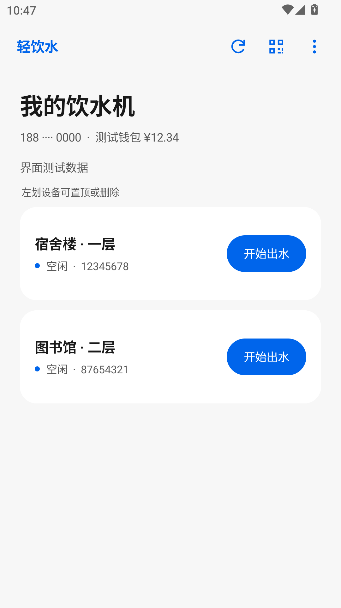
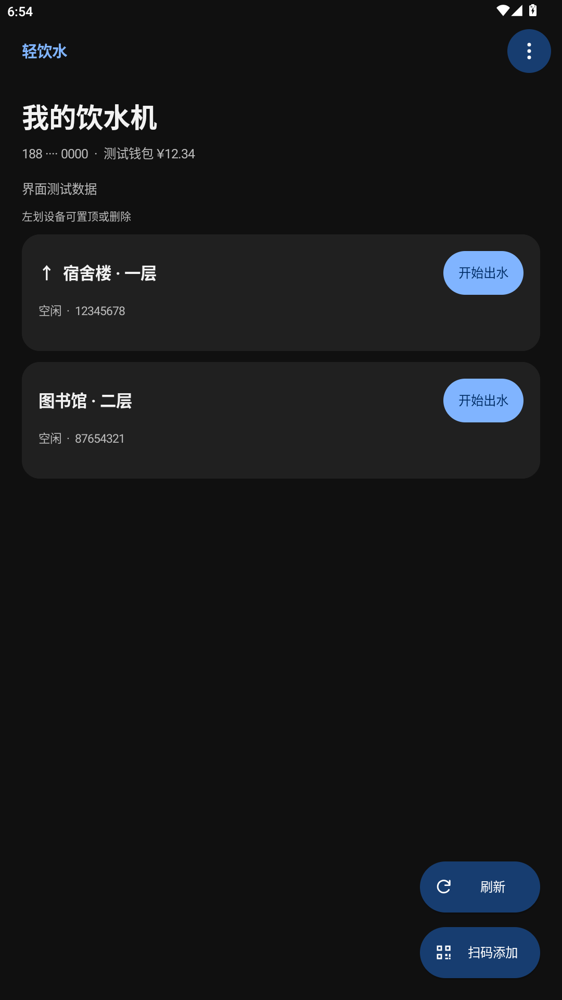
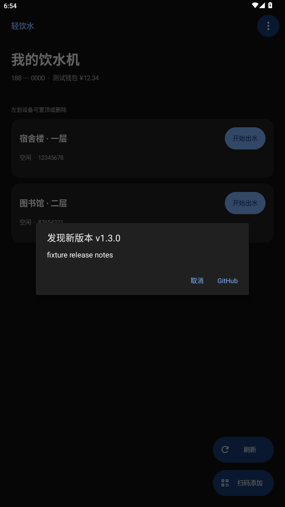

# 轻饮水 · WaterLite 1.2.0

慧生活798饮水功能精简 Android 客户端。原生界面，MIUI风格固定配色，支持深浅色，无底部导航。

**[下载最新版本](https://github.com/esn-idiotzzz/WaterLite/releases/latest)** · [使用说明](docs/USAGE.md) · [构建说明](docs/BUILDING.md)

## 本版更新

- 参考life-798更新设备端协议至3.1.9：短信和设备登录均用ApplicationType 1,1，登录带签名，结束请求包含rcp=false。
- 修复清理后台后的过期出水标记：本地记录只作为待核实提示，保留停止能力；经过启动保护期后，首轮明确空闲响应即可恢复开始按钮。仍在运行或网络异常时不会假装设备已停。
- 每次进入前台独立检查本仓库的GitHub正式版本，显示版本、更新内容和“取消”“GitHub”选项；点击GitHub打开对应版本下载页，不自动下载安装。网络失败不影响接水。
- 取消莫奈壁纸取色，保留圆角按钮、按压、启停颜色过渡与左划动画。三个操作按钮共用深浅色配色，刷新在右下角扫码添加上方，两者同尺寸，左图标右文字；刷新只旋转图标。
- 复用设备行、保留刷新滚动位置、减少重复写入与扫码分配；刷新成功后避免立刻重复查询同一状态。

## 使用

短信登录后显示饮水机，支持扫码/手动添加、余额、自动状态检测、一键启停和左划置顶/删除。删除只隐藏本应用快捷入口，再次扫码可恢复。充值与代扣签约仍在官方应用完成。

最低Android 8.0，目标Android 15。原签名、包名和数据字段保持不变，可从本项目1.0.0–1.1.0直接覆盖更新，勿先卸载。登录信息由Android Keystore加密；断网、超时、版本提示和临时业务错误不会清空凭证，只有服务端明确返回-99时要求重新验证。无法保证服务端凭证永久有效，未使用未经证实的续期接口。

## 预览

  

预览中的账号、余额、设备与更新版本为测试数据。

## 验证与范围

模拟器Android12L/API32执行启停、启动延迟、网络失败、后台恢复、主题对比度、更新解析/弹窗、列表复用等检查，另通过真实am force-stop后的独立进程恢复测试。完整结果见[test-results.txt](test-results.txt)。测试使用模拟接口，未发送真实短信或出水命令。未在小米15上测试实际帧率、真实登录、相机或出水；尚未验证数日会话有效期。

## 来源与许可

本应用为非官方客户端，与学校及慧生活798服务商无关联。使用本人有权访问的账号和设备，遵守服务规则。

饮水接口最初改编自GPL-3.0许可的abcde2333/NcepuJw；1.2.0登录协议对照[nocookies111/life-798](https://github.com/nocookies111/life-798)（MIT）。本项目继续按GPL-3.0发布；详细来源及第三方许可见[NOTICE.md](NOTICE.md)、[LICENSE](LICENSE)与[third-party](third-party)。
