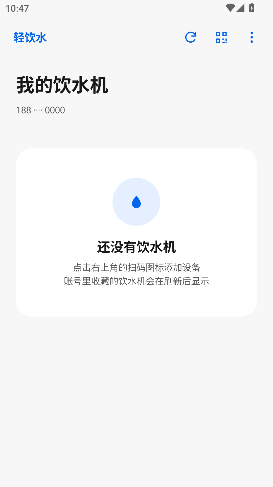

# 轻饮水 · WaterLite 1.3.0

慧生活798饮水功能精简 Android 客户端。原生界面，MIUI风格固定配色，支持深浅色，无底部导航。

**[下载最新版本](https://github.com/esn-idiotzzz/WaterLite/releases/latest)** · [使用说明](docs/USAGE.md) · [构建说明](docs/BUILDING.md)

## 本版更新

- 刷新、扫码、更多收进右上角工具栏，从左到右依次为刷新、扫码、更多；去掉底部大按钮，只保留小图标，刷新仍只旋转图标。
- 重排设备卡片：名称和状态集中在左侧，开始/停止出水按钮固定在右侧并上下居中；统一卡片高度，加入状态圆点与更清晰的层次。
- 重做左划操作：置顶和删除改为两个圆角色块，图钉/垃圾桶图标与文字紧凑贴合；置顶后图钉向右旋转45°，文字变为“取消置顶”。
- 调整空列表引导、间距、字号和深色配色，整体更接近MIUI的轻量卡片风格。
- 版本号为1.3.0（versionCode 6），沿用1.2.0签名、包名和数据字段，可直接覆盖升级。

## 使用

短信登录后显示饮水机，支持扫码/手动添加、余额、自动状态检测、一键启停和左划置顶/删除。删除只隐藏本应用快捷入口，再次扫码可恢复。充值与代扣签约仍在官方应用完成。

最低Android 8.0，目标Android 15。原签名、包名和数据字段保持不变，可从本项目1.0.0–1.1.0直接覆盖更新，勿先卸载。登录信息由Android Keystore加密；断网、超时、版本提示和临时业务错误不会清空凭证，只有服务端明确返回-99时要求重新验证。无法保证服务端凭证永久有效，未使用未经证实的续期接口。

## 预览

   

预览中的账号、余额、设备与更新版本为测试数据。

## 验证与范围

MuMu模拟器Android 12（1080×1920，420dpi）执行深浅色启停、启动延迟、网络失败、后台恢复、主题对比度、更新解析/弹窗、列表复用、顶栏图标顺序、卡片按钮垂直居中和左划操作等检查，另通过真实am force-stop后的独立进程恢复测试。完整结果见[test-results.txt](test-results.txt)。测试使用模拟接口，未发送真实短信或出水命令。未在小米15上测试实际帧率、真实登录、相机或出水；尚未验证数日会话有效期。

## 来源与许可

本应用为非官方客户端，与学校及慧生活798服务商无关联。使用本人有权访问的账号和设备，遵守服务规则。

饮水接口最初改编自GPL-3.0许可的abcde2333/NcepuJw；1.2.0登录协议对照[nocookies111/life-798](https://github.com/nocookies111/life-798)（MIT）。本项目继续按GPL-3.0发布；详细来源及第三方许可见[NOTICE.md](NOTICE.md)、[LICENSE](LICENSE)与[third-party](third-party)。
