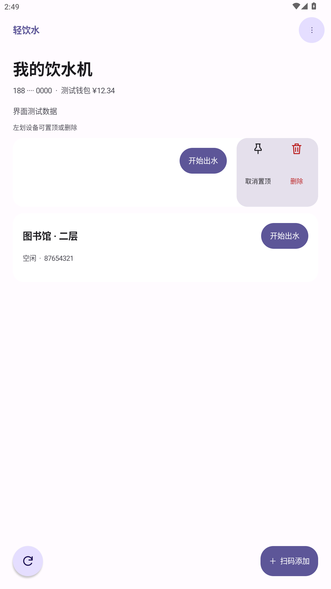

# 轻饮水 · WaterLite

慧生活798饮水功能的精简 Android 客户端。原生界面、全局莫奈取色，没有底部导航。

**[下载最新 APK](https://github.com/zhouyangxin13-ai/WaterLite/releases/latest)** · [使用说明](docs/USAGE.md) · [构建与实现说明](docs/DEVELOPMENT.md)

## 功能

- 手机号短信验证码登录，加密保存登录凭证。临时断网和服务错误不会直接清空登录状态；服务端明确令凭证过期时需要重新验证。
- 登录后显示饮水机，支持扫码或手动添加，查看设备状态与钱包余额。
- 一键开始或停止出水，无二次确认；自动检测运行状态和自动停水，返回前台立即核实状态。
- 左划设备置顶或删除，长按修改名称；刷新保留列表滚动位置。
- Android 12及以上全局跟随系统莫奈配色及深浅色，停止按钮保留红色语义；较旧系统使用统一回退配色。
- 启停颜色过渡、按压反馈、左划渐显及置顶移位动画，遵循系统动画开关；后台停止动画。

只保留饮水功能。充值、代扣签约及一卡通绑定请使用慧生活798原应用。

## 预览

<p>
  
  
  
</p>

截图中的账号、设备和余额均为测试数据；实际配色由手机系统提供。

## 安装

最低 Android 8.0，目标 Android 15。下载 Release 中的 `WaterLite-1.1.0.apk` 后安装。

已安装本项目交付的1.0.0–1.0.2时可直接覆盖更新，保留登录和设备；请勿先卸载。其他来源或自行构建的不同签名版本不能直接覆盖。

应用仅声明网络和相机权限，扫码时申请相机权限。凭证由 Android Keystore AES-GCM 加密，设备数据按账号隔离，本地数据关闭系统备份。

## 构建与验证

标准工程使用 JDK 17、Android SDK 35、Gradle 8.11.1和AGP 8.9.2：

```sh
./gradlew assembleDebug
```

Windows 使用 `gradlew.bat assembleDebug`，并按本机环境设置 `local.properties` 中的 `sdk.dir`。直接构建脚本及正式交付 APK 的实际工具链见[构建说明](docs/DEVELOPMENT.md)。发布签名密钥不在仓库内。

1.1.0在MuMu Android 12L/API 32模拟器的深色、浅色及另一套系统配色下，各通过69项检查。独立测试包使用模拟接口，不发送真实短信或出水命令，详见 [test-results.txt](test-results.txt)。尚未验证小米15/Android 15实机帧率、物理相机、真实饮水机及多日登录稳定性。

## 来源与许可

本项目为非官方客户端，与学校及慧生活798服务商无关联。使用自己的账号，遵循服务商规则，避免高频请求。

饮水接口与错误码实现改编自 [abcde2333/NcepuJw](https://github.com/abcde2333/NcepuJw)，按 **GPL-3.0** 发布。钱包数据结构参考MIT许可的life-798，二维码解码使用Apache-2.0许可的ZXing。完整来源及第三方声明见 [NOTICE.md](NOTICE.md)、[LICENSE](LICENSE) 和 [third-party](third-party)。
