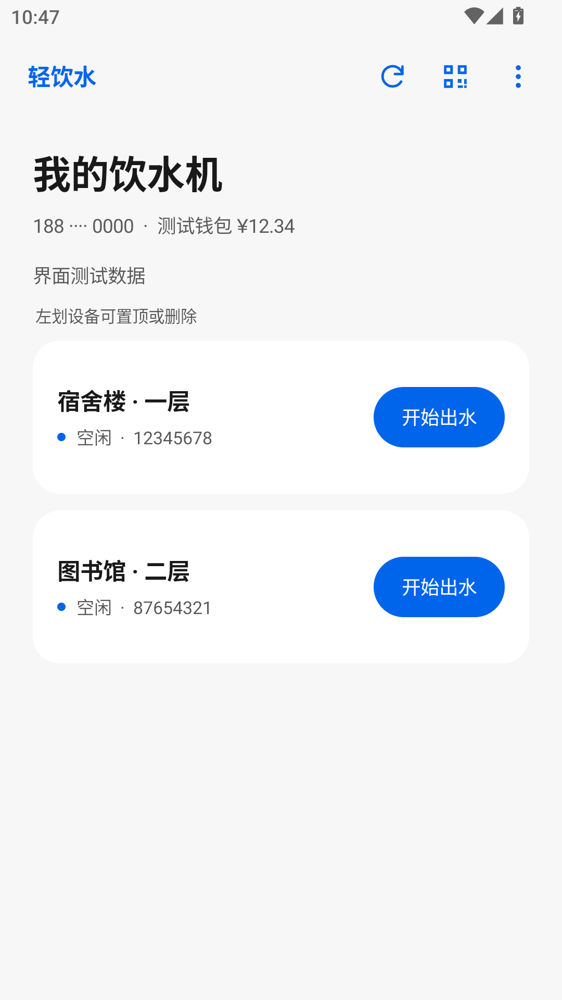
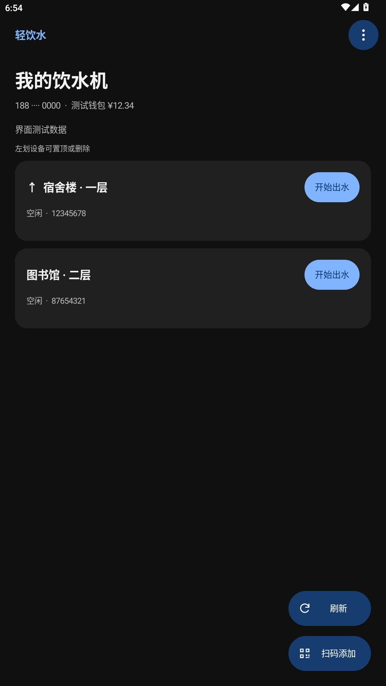
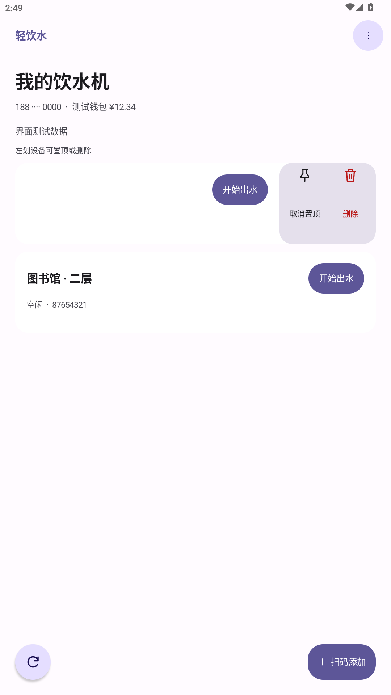
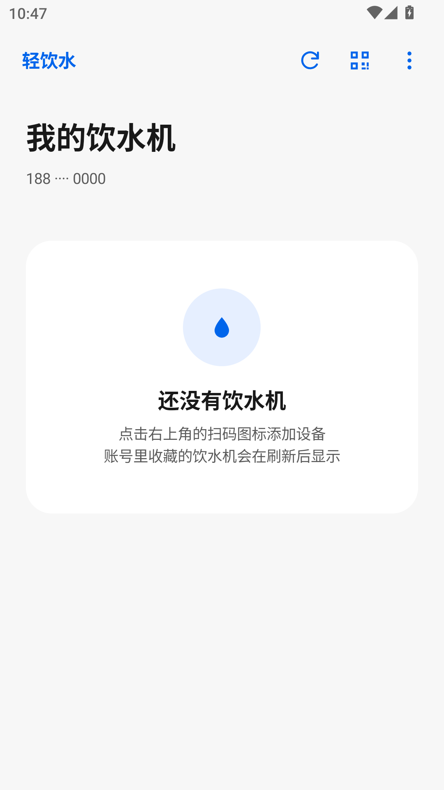

# 轻饮水 · WaterLite 1.3.1

慧生活798饮水功能精简 Android 客户端。原生界面，MIUI风格固定配色，支持深浅色，无底部导航。

**[下载最新版本](https://github.com/esn-idiotzzz/WaterLite/releases/latest)** · [使用说明](docs/USAGE.md) · [构建说明](docs/BUILDING.md)

## 本版更新

- 启动时先显示本地缓存，延迟片刻后台静默同步；不再闪现“正在刷新…”或旋转刷新图标，设备列表和滚动位置不重建。
- 余额摘要写入本地，下次启动直接显示；网络回来后只更新同一行文字，避免加载完成后突然多出一段余额。
- 设备状态文字变更时轻微淡入，减少状态从“检测中”变为“空闲”时的突跳。
- 修复静默同步与置顶、删除、重命名、长按菜单并发时可能覆盖本地操作的问题。
- 保留1.3.0的顶栏、居中操作按钮、左划色块与45°图钉设计；版本号1.3.1（versionCode 7），沿用原签名与包名，可直接覆盖升级。

## 使用

短信登录后显示饮水机，支持扫码/手动添加、余额、自动状态检测、一键启停和左划置顶/删除。删除只隐藏本应用快捷入口，再次扫码可恢复。充值与代扣签约仍在官方应用完成。

最低Android 8.0，目标Android 15。原签名、包名和数据字段保持不变，可从本项目1.0.0–1.3.0直接覆盖更新，勿先卸载。登录信息由Android Keystore加密；断网、超时、版本提示和临时业务错误不会清空凭证，只有服务端明确返回-99时要求重新验证。无法保证服务端凭证永久有效，未使用未经证实的续期接口。

## 预览

   

预览中的账号、余额、设备与更新版本为测试数据。

## 验证与范围

MuMu模拟器Android 15（1080×1920，420dpi）执行深浅色启停、启动延迟、静默启动、钱包持久化、网络失败、后台恢复、主题对比度、更新解析/弹窗、列表复用、顶栏图标顺序、卡片按钮垂直居中和左划操作等检查，另通过真实am force-stop后的独立进程恢复测试。完整结果见[test-results.txt](test-results.txt)。测试使用模拟接口，未发送真实短信或出水命令。未在小米15上测试实际帧率、真实登录、相机或出水；尚未验证数日会话有效期。

## 来源与许可

本应用为非官方客户端，与学校及慧生活798服务商无关联。使用本人有权访问的账号和设备，遵守服务规则。

饮水接口最初改编自GPL-3.0许可的abcde2333/NcepuJw；1.2.0登录协议对照[nocookies111/life-798](https://github.com/nocookies111/life-798)（MIT）。本项目继续按GPL-3.0发布；详细来源及第三方许可见[NOTICE.md](NOTICE.md)、[LICENSE](LICENSE)与[third-party](third-party)。
